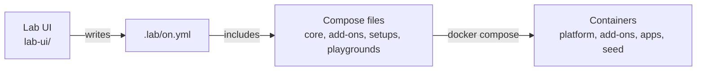

# Contributing to Gravitee Lab

Thank you for helping. This page tells you how the project fits together, how to set up your machine, and what to check before you open a pull request.

## Ways to help

- **Report a bug** or ask a question: open an issue in the Issues tab of this repository and fill in the form. For a vulnerability, follow [SECURITY.md](SECURITY.md) instead.
- **Improve the documentation**: fix a step that does not work, a link, or a sentence that is hard to follow.
- **Add an add-on, a setup or a playground** to a catalog: see [Add an add-on, a setup or a playground](#add-an-add-on-a-setup-or-a-playground).
- **Change the Lab UI, the seeder or an app** of a playground.

For a large change, open an issue first so that we can agree on the approach before you write it.

## The project in five minutes

The seed of a playground is a container built from `seeder/`. It creates the playground's APIs, users and policies through the platform's management APIs.

| Path | What it is | Rules |
|---|---|---|
| `docker-compose.yml` | The core: API Management, Access Management, Alert Engine, Gamma and the databases | [AGENTS.md](AGENTS.md) |
| `.lab/catalogs/<id>/` | The catalogs installed on a machine, read only and git-ignored: the add-ons, setups and playgrounds, which live in their own repositories | [Catalogs](docs/catalogs.md), [the format of the units](docs/units.md) |
| `seeder/` | The engine every playground's seed runs | [seeder/AGENTS.md](seeder/AGENTS.md) |
| `lab-ui/` | The Lab UI, its page and its tests | [lab-ui/AGENTS.md](lab-ui/AGENTS.md) |
| `docs/` | The documentation | [Documentation](#documentation) |
| `.github/` | CI, the workflow and script that publish the images, the templates, and `tests/` for the Makefile, the images script and the Compose conventions | [Pull requests and review](#pull-requests-and-review) |

The `AGENTS.md` files are written for AI agents, but they are the reference for the rules too: read the one of the folder you change.

Three principles run through the project:

- **Standard Compose only.** `include`, `x-` extensions, labels and `${VAR:-default}` carry everything. A person who runs `docker compose` gets the same result as the Lab UI.
- **One way for each thing.** Before you add a piece, find the one that does it already.
- **The Lab UI knows no product.** It reads the Compose files (`x-gravitee` blocks, labels, `include`, `image:` lines). No list of products, add-ons or images lives in its code.

## Set up your machine

1. Install the [Prerequisites](docs/installation.md#prerequisites).
2. Run `make setup`. It makes `.venv` with the seeder's requirements (`requests`, `pyyaml`, `redis`) and `ruff`, and needs Python 3.10 or later. If your `python3` is older, name a newer one: `PYTHON3=python3.12 make setup`. A `.venv` that `make setup` made with a Python that is too old is removed again; one that existed before is left for you to remove.
3. Node 22.7 or later (20.19 or later in the 20 line) is optional: it runs the Lab UI page tests. Docker is needed by `make e2e`.

A test whose dependency is missing prints a skip line, such as "Seeder tests skipped". A skipped test did not pass: read the output.

There is one lab per machine: the Compose project is named `gravitee` and its containers are `gio-*`. Stop another clone's lab (`make stop` there) before you start yours. `make reset` deletes the containers and the data volumes of the whole project, the core's and every add-on's, and empties what the playgrounds' seeds recorded. The Containers page's **Reset** does the same and also turns off the playground that is on.

## Workflow

1. Fork the repository and clone your fork.
2. Branch from `main`. Name the branch `feature/<name>`, `fix/<name>` or `docs/<name>`.
3. Make one logical change per pull request.
4. Rebase on `main` before you open the pull request.
5. Open the pull request. A draft is welcome for early feedback. Maintainers squash-merge it.

## Before you open a pull request

| You changed | Run | Expected |
|---|---|---|
| Anything | `make check` | It prints "All good" |
| Python code | `make lint` | No findings |
| The Lab UI, the seeder, the Makefile or `.github/` | `make test` | The tests pass |
| Something that runs | `make smoke` | The Lab UI agrees with the running stack (read-only) |
| An add-on, a setup or a playground | `make check` and `make ci` in its catalog's repository | The catalog's own rules pass and its apps build and start. Its CI runs the end-to-end test for you |
| Documentation | Click your links | Every link and anchor resolves, and commands work as written |
| The Lab UI's look | `make ui` | It looks right in the light and the dark theme |

CI runs the same checks on every pull request.

## Add an add-on, a setup or a playground

Items do not live in this repository: they live in catalogs. The ones the Lab shows by default are in the
[Gravitee public catalog](https://github.com/gravitee-io-labs/gravitee-lab-public-catalog), which has its own contributing guide and its own CI.
Open the pull request there. [Writing a catalog](docs/writing-a-catalog.md) says how to start a catalog of your own, and
[the format of add-ons, setups and playgrounds](docs/units.md) is what every item follows. To try an item on your machine
before sharing it, make it in **Personal** (the **New** buttons of the lists) and **Share** it when it works.

## Change the Lab UI

- The server uses only Python's standard library and runs on Python 3.9 or later. The page is plain ES modules and CSS, with no build step and no new dependency.
- Keep the copy terse: sentence case, no helper sentences.
- Reuse the existing components (the picker, the pager, the rows) before you add one.
- Add tests in `lab-ui/tests` and run `make test`.

## Documentation

| Where | What lives there |
|---|---|
| [README.md](README.md) | What the lab is and where to start |
| `docs/` | Installation, the Lab UI, configuration, playgrounds, Gravitee Cloud, troubleshooting and maintaining the repository |
| A folder's `README.md` | What a user needs to know about one add-on or playground beyond its settings |
| `AGENTS.md` files | The rules for people who change the project |
| Comments in Compose files | One line for each setting: the Lab UI shows them next to the setting |

Write in American English, with sentence case headings, imperative sentences and short paragraphs. Draw diagrams in Mermaid. Name files and folders in lowercase with dashes.

## Conventions

- Never commit `.env` files, `.lab/`, `plugins/`, secrets, licenses, keys or certificates. Git ignores them: check `git status` before you commit.
- A compose file holds no literal password, secret, token or key. Write a setting: `${NAME:-default}`, whose default may be a public demo value, or `${NAME}` when the user must provide it. `make check` refuses a literal in a shared file ([the rule](AGENTS.md#rules)).
- An item of a catalog never includes a personal one.
- A comment describes a setting or a non-obvious reason, never who wrote the code.
- Files use LF line endings (`.gitattributes` and `.editorconfig` enforce it).
- A commit message has a plain imperative subject (aim for 72 characters or fewer) and a body that explains why. Do not add tool-generated trailers or credits.

## Use an AI agent

`AGENTS.md` is the contract for any agent. Codex, Copilot and Cursor read it as it is, Claude Code through `CLAUDE.md`, and Gemini CLI through `.gemini/settings.json`. The skills `new-addon`, `new-setup`, `new-playground`, `new-catalog`, `share-item` and `prepare-pull-request` live in `.agents/skills/`, with a stub for each in `.claude/skills/`; `make check` enforces that wiring.

You stay the author: read every line the agent writes, run the checks yourself, and do not submit what you do not understand.

## Pull requests and review

The pull request template asks what changed and why, how you tried it, and for a checklist: `make check` prints All good, `make lint` and `make test` pass, you tried it in the Lab UI, the change holds no secrets, `.env` or `.lab/` files, and the docs are up to date.

Maintainers review on a best-effort basis.

### What CI does

Every pull request, from any fork, gets these jobs with no secret and no wait: **Lint**, **Compose files** (`make check` with the Compose release the lab pins and with the newest one, which is what a Linux user gets from Docker's repository, then the builds of the seeder's image, printed and not run), **Repository tests** (the tests of `.github/tests`), **Seeder tests**, and **Lab UI tests** (Python 3.9 and 3.14, each in four parts that take about as long, from the seconds in `lab-ui/tests/durations.json`: `python3 lab-ui/tests/run.py --time` writes them again when the parts drift apart). **CI result** passes when all of them did: it is the check a merge waits for. **Default catalog** checks the default catalog with your change, so that a change of the engine that breaks it shows on the pull request: it is not required, since the fix may belong to the catalog.

The engine holds no item, so the **E2E** workflow tries the canary of the default catalog (`canary:` in its `catalog.yml`) on the engine as your change leaves it. A change that touches nothing every item shares (documentation, the page) runs nothing. Each catalog runs the same test for its own changes.

| Job | What it proves | Who can run it |
|---|---|---|
| `Images of <item>` | Every image it pulls exists in its registry, at that version | Anyone: it needs no secret |
| `<item>` | It starts on a machine with no lab, as it does from the Lab UI: the start ends well (a playground's seed too), its containers are up and none is in an issue, and its consoles answer | A maintainer approves it after reading the change: it runs your code with the CI license |
| `E2E result` | Everything above ended well. This is the check that has to pass before a merge | |

The canary also runs every night on `main`, and a failure opens an issue.

An item that cannot be tried by CI (it needs a setting only a person can give, such as a token) is reported as *not tried* in the summary of the job, and a maintainer tries it by hand. The pull request of a fork waits for a maintainer, who runs it after reading it ([Maintaining](docs/maintaining.md#end-to-end-runs)). To try an item on your machine, run `make e2e ID=<kind>:<id>` on a machine that holds no lab: it refuses one that does, since it removes what it starts.

## Review before you run

Starting someone else's pull request, a personal item or a shared playground runs their containers, Dockerfiles, seeds and Makefile code with your Docker access ([what that exposes](SECURITY.md#what-the-lab-exposes)). Read the change first: the Compose files (commands, mounts, ports), the Dockerfiles, the seed files and the `Makefile`. Maintainers do the same before they run a pull request, and CI does not run a pull request's items with the license until one of them has approved it.

## Test your change like a new user

Your machine hides what a fresh clone lacks, such as a file you forgot to commit. Before a pull request:

1. Clone your branch into a new folder.
2. Stop any other lab that runs on your machine.
3. Run `make ui` there.
4. Start something from the Lab UI, an item of a catalog or one of yours.
5. Run `make check`.

## Images and releases

When a push to `main` changes the seeder or the core file (a Markdown file alone builds nothing), CI builds the seeder's image and pushes it to `ghcr.io/gravitee-io-labs/gravitee-lab`, as `latest` and as `sha-<commit>`, so that a playground's seed pulls it instead of building it. The image carries the label `org.opencontainers.image.licenses=AGPL-3.0-only`. A catalog publishes the images of its own items by its own workflow. Contributors never push images. There are no versioned releases: `main` is what users get, so it must always run.

## Maintainers

Maintainers: see [docs/maintaining.md](docs/maintaining.md) to move or fork the repository, for the one-time GitHub settings and for the pins to review.

## License of contributions

Your contribution is licensed under the project's license, the GNU Affero General Public License v3.0 (see [LICENSE](LICENSE); [NOTICE](NOTICE) requires its attribution to stay). There is no contributor license agreement, and no sign-off is required.
