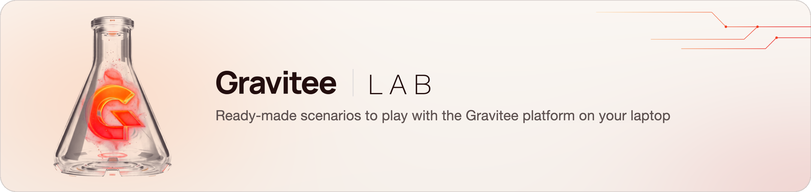
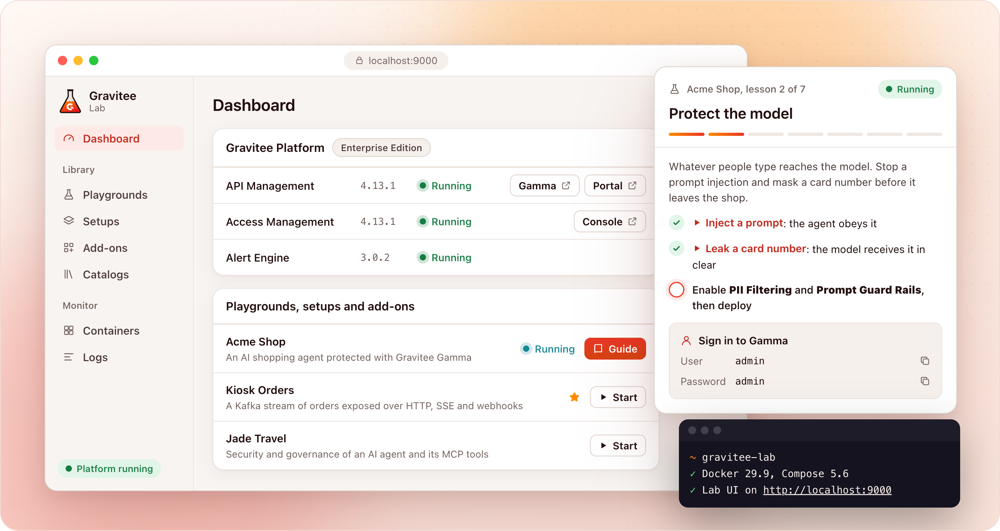

<picture>
  <source media="(prefers-color-scheme: dark)" srcset="docs/images/banner-dark.png">
  
</picture>

<p align="center">
  <a href="https://github.com/gravitee-io-labs/gravitee-lab/actions/workflows/ci.yml"></a>
  <a href="LICENSE"></a>
  
</p>

<p align="center">
  <b>The whole Gravitee platform on your laptop, with ready-made use cases to try, demo and learn.</b><br>
  One command to install, then everything is a click.
</p>

<picture>
  <source media="(prefers-color-scheme: dark)" srcset="docs/images/lab-ui-dark.png">
  
</picture>

## Get started

You need Docker with 8 GB of memory and 15 GB of free disk. The installer brings the rest.

### 1. Install

**macOS or Linux**, in a terminal:

```bash
curl -fsSL https://github.com/gravitee-io-labs/gravitee-lab/raw/main/install.sh | sh
```

**Windows**, in PowerShell:

```powershell
irm https://raw.githubusercontent.com/gravitee-io-labs/gravitee-lab/main/install.ps1 | iex
```

It asks before it installs anything, adds only what is missing and can run again at any time.
[What it does](docs/installation.md#install).

<details>
<summary>Install by hand</summary>

With Git, Make, Python 3.9 or later and OpenSSL ([details](docs/installation.md#prerequisites)):

```bash
git clone https://github.com/gravitee-io-labs/gravitee-lab.git
```

```bash
cd gravitee-lab && make ui
```

</details>

### 2. Start

The [Lab UI](http://localhost:9000) opens in your browser. Click **Start all**.

The first start downloads about 15 GB of images: allow 10 to 15 minutes.

### 3. Play

Open a console from the **Dashboard**, or pick a playground: a use case with its apps, sample data and a guide that walks
you through it.

| Console | Sign in |
|---|---|
| API Management and Gamma | `admin` / `admin` |
| Access Management | `admin` / `adminadmin` |

No license is needed to start: [what needs one](docs/installation.md#what-needs-a-license). Stuck? See
[Troubleshooting](docs/troubleshooting.md).

## Already installed

| To | Do |
|---|---|
| Open the Lab UI | Run `gravitee-lab`, or on Windows open **Gravitee Lab** from the Start menu |
| Update the Lab | Click **Update** in the Lab UI |
| Stop the containers | Click **Stop** on the Containers page, or run `gravitee-lab stop`. The data stays |
| See every command | Run `gravitee-lab help` |
| Remove it | Run `gravitee-lab uninstall`, then [delete the data and the folder](docs/installation.md#stop-update-remove) |

Cloned it yourself? `make ui` in the clone does what `gravitee-lab` does. Run the installer once to get the command: it keeps
your clone as it is.

## What is inside

- **The platform**: API Management, Access Management, Alert Engine, Gamma and their databases, ready to use.
- **Playgrounds**: use cases with their apps, sample data and a guide, from AI agents to event streams.
- **Add-ons**: one extra capability each, such as a tracing console, an authorization server or Kafka.
- **Setups**: several add-ons that start and stop as one.

They come from [catalogs](docs/catalogs.md). The Lab downloads the default one the first time it starts, and you can add
your own or your team's.

## Learn more

| Use the Lab | Build for the Lab | Take part |
|---|---|---|
| [Install and run](docs/installation.md) | [Catalogs](docs/catalogs.md) | [Contributing](CONTRIBUTING.md) |
| [Lab UI](docs/lab-ui.md) | [Writing a catalog](docs/writing-a-catalog.md) | [Security](SECURITY.md) |
| [Configuration](docs/configuration.md) | [Writing a playground](docs/playgrounds.md) | |
| [Gravitee Cloud](docs/cloud.md) | [Add-ons, setups and playgrounds](docs/units.md) | |
| [Troubleshooting](docs/troubleshooting.md) | [Reading a failed check](docs/catalog-rules.md) | |

For local demos and learning, not for production. Licensed under the [AGPL-3.0](LICENSE), with the attribution in [NOTICE](NOTICE).
