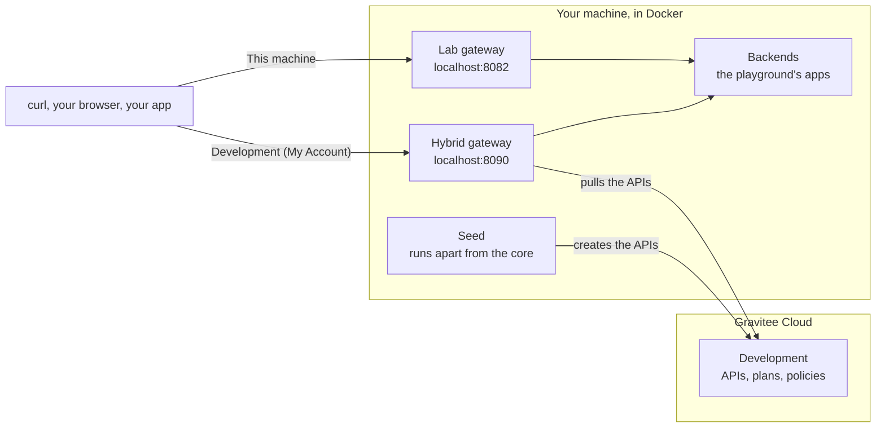
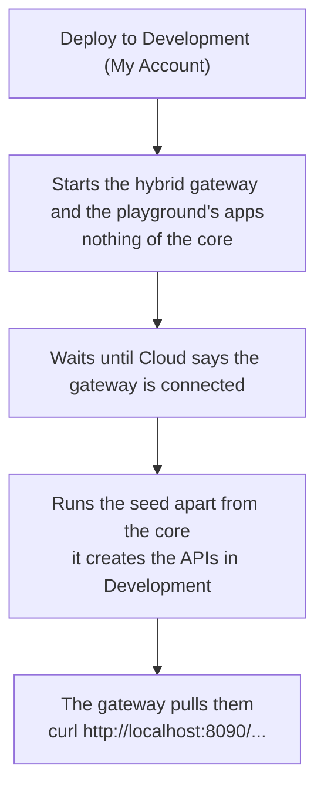
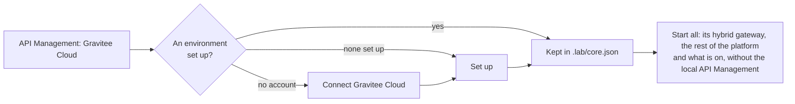

# Use Gravitee Cloud with the Lab

Gravitee Cloud hosts the control plane of API Management: the console where you design and deploy APIs. The Lab can
connect your Cloud account, run a hybrid gateway in its own Docker network, and deploy what a playground creates into
a Cloud environment, so that the APIs you manage in Cloud reach the lab's containers as backends. You do not need the
rest of the lab for that: a deploy to Cloud starts none of the core.

## Where things run

*Deploy to* offers places. A place is *This machine*, the lab's own API Management, or one environment of a Gravitee Cloud account you
connected, written *Development (My Account)*: the environment, then the account in parentheses. The containers
always run here. The place says where the playground's APIs are created and managed.



| | Where | What it does |
|---|---|---|
| Control plane | Gravitee Cloud, EU region | API Management, at the version its gateways report. You design and deploy APIs in its console, or a playground's seed does |
| Gateway | Your machine: the [Hybrid gateway](https://github.com/gravitee-io-labs/gravitee-lab-public-catalog/blob/main/addons/hybrid/README.md) add-on, `apim-hybrid-gateway`, port 8090 | Pulls the APIs from Cloud every 10 seconds, applies their policies, calls the backends and sends its analytics to Cloud |
| Backends | Your machine: any container of the lab | Reached as `http://<service>:<container port>` on the lab's internal network |
| Lab UI | Your machine: the Gravitee Cloud page and the *Deploy to* picker | Registers your account, creates the gateway, keeps your tokens, deploys a playground |

## Before you start

- A Gravitee Cloud account, and a user of it with the role `ACCOUNT_PRIMARY_OWNER` or `ACCOUNT_OWNER`, which creating a
  gateway needs.
- A license with the feature `apim-bridge-gateway`, for the gateway: the core's, or one in `HYBRID_LICENSE`
  ([Needs](https://github.com/gravitee-io-labs/gravitee-lab-public-catalog/blob/main/addons/hybrid/README.md#needs)).
- Outbound HTTPS from your machine to `eu.cloud.gravitee.io` and `eu.cloudgate.gravitee.io`.
- The lab running: `make ui`. The core can stay stopped.

## Add your account

1. In the Lab UI, open **Gravitee Cloud** and choose *Connect account*. The **Dashboard** has a *Connect account* button
   that opens the same dialog, *Connect Gravitee Cloud*: two steps, *Account* then *Environment*, in one dialog. Beside the
   fields of each step is a picture of the Cloud console that shows where each value is, numbered as the lines of the step.
2. Choose *Open Gravitee Cloud* (no account yet: *Register for free*, under it). In the console, open Settings, Account
   Tokens, generate an Account Token and copy it (1 on the picture), then copy the Account ID shown at the top of the same
   page (2). Both are needed: the token alone cannot say whose it is ([why](#why-the-account-id-is-asked)). In the dialog,
   the information mark of each label says what it is and where it is; the token's says what it is for: it reads the
   account, and deploys nothing.

   | Field | What to enter |
   |---|---|
   | Account Token | The token you copied. The Lab keeps it on this machine and never shows it again |
   | Account ID | The UUID the Account Tokens page shows. Anything else is refused before it is sent |
   | URL, under *More options* | `https://eu.cloud.gravitee.io`, already there. Change it only for the fake Cloud or a Cloud of your own. *Open Gravitee Cloud* follows it |

3. Choose *Connect*. The Lab checks the pair with Cloud, names the card after the account (*More*, then *Rename*, to
   change it; the name is the part in parentheses of every place), and lists the environments of the account, such as
   Development, Test and Production, each *Not set up*. The card shows behind the dialog, which goes on to its second step:
   [set up a first environment](#set-up-an-environment), Development by default, or *Skip for now*. The account stays
   connected whichever you choose, and however the dialog closes. An account with no environment, or whose environments
   cannot be read, ends the dialog there, with a message that says so.

### An account is connected once

The Account ID tells whose an account is, so the Connect form says it as soon as the ID is whole: *Already connected as <name>*, with a link to replace its Account Token, and Connect stays off. The server refuses it too, whatever the name or the token, before asking the Cloud anything.

### Why the Account ID is asked

An Account Token reaches the paths of its own account, `/management/accounts/{account id}/...`, and nothing else. Checked
against Gravitee Cloud (EU) on 2026-10-12 with a real Account Token, read only: `GET /management/accounts`, `/me`,
`/me/permissions` and `/cloud/accounts` answer 401, so no call says which account a token belongs to, and the token, a
UUID, carries no claim. With the Account ID, `GET /accounts/{id}` answers the account's name and hrid, and
`/accounts/{id}/organizations` its organizations (each with its region), so the Lab asks for nothing else: the name, the
organizations and the environments are read. The US Cloud has no documented console address, so the form has no region
choice: another address goes under *More options*.

The state in the head of the card says whether the account can be used: *Connected*, *Account Token refused* (Cloud
refuses the Account Token, which has been revoked or has expired: *More*, then *Replace Account Token*) or
*Unreachable*. While it is not *Connected*, the card gives the cause first and says that its environments cannot be
listed, with the button that fixes it, and none of them can be deployed to. An account that answered before and does not
answer a moment later keeps its table, with a notice above it, *Showing what was read before*: the Lab reads it again
by itself every 30 seconds. The head of the card has *Open console* too, which opens the account's console: the Lab
knows no address for the console of one environment, so there is no such button on a row.

## Set up an environment

Each environment of the card is *In use* or *Not set up*. An environment is in use once it holds a hybrid gateway (any,
so that one the Lab cannot use can be removed), a gateway Cloud deleted while it ran here, a Cloud Token of the Lab's, or
something the Lab deployed in it. The others are one quiet line each, with *Set up*. When more than two of them would
show, the card lists two and says *Show 3 more environments*.

Choose *Set up*. It opens *Set up Development*, the second step of *Connect Gravitee Cloud* for that environment alone, with
two parts, both ticked, which you may leave out (their fields show while they are ticked):

- *Run a gateway here* creates the [hybrid gateway](#create-a-hybrid-gateway) of the environment, named *Gravitee Lab -
  Development*, keeps its token and **starts it**, through the same dialog as a Start. When another environment's gateway
  runs here, a line says so before: *The gateway of Test runs here now: starting this one stops it*.
- *Allow deploys* keeps the [Cloud Token](#add-a-cloud-token) you paste. *Open Gravitee Cloud* opens the account's console,
  where you open Settings, Cloud Tokens and generate a Cloud Token (1), then choose the type Automation and this environment,
  confirm, and copy the token (2). The pictures beside show both screens of the console, one at a time: choose *1 Generate*
  or *2 Choose the environment* above them, or click a line.

The same step follows *Connect*, where you also choose the environment. If the token is kept and the gateway is refused,
the dialog stays open with the reason and the token part marked *Done*:
sending it again makes the gateway only, and closing it still shows the token on the card. Each step has its own button
afterwards, so you can set up an environment in two visits. To undo both, open the row's *More* and choose *Stop using
Development*: one dialog lists the gateways and the Cloud Token that go, what it turns off, and what stays (the token in
Cloud and what was deployed).

## Create a hybrid gateway

A hybrid gateway runs on this machine and gets its APIs from a Cloud environment, so that traffic is served here. Each
environment has its own.

1. In the environment's row, whose *Gateway* reads *Not created*, choose *Create gateway*. (*Set up* does
   it too, with the Cloud Token.)
2. Check the name (*Gravitee Lab - Development* by default, named for its environment so that two are told apart in
   Cloud), then choose *Create and start*. The title says the environment, and the form does not ask for it.

The Lab creates the gateway in Cloud with two domains and keeps its token. You never copy or see it. The first gateway
you create is the one that runs on this machine: the Lab writes its token in the settings of the Hybrid gateway add-on.
One hybrid gateway runs here at a time. A gateway you create while another runs is kept, and starting it swaps the
other one: the form says *The gateway of Test runs here now: starting this one stops it*, and the dialog of the start
lists what it restarts and which environment it stops serving. The gateway is started at once, unless the add-on lacks a
license: the row then offers *Add license* and starts nothing.

The row's *Gateway* column shows a dot and a word, on one line. Its popover has the name of the gateway, its version and, while
it runs here, the address to call (`localhost:8090`; *Copy address* in the row's *More* copies it). An environment with several
gateways says how many (*2 gateways*), and *Hybrid gateways*, under the environments, lists every gateway of the account with its
environment, its state, its version and its domains, each with its *Start*, *Stop* or *Remove*. The Dashboard says how many there
are, and lists them in the popover of that number.

| Word | Meaning |
|---|---|
| *Running here* | It runs on this machine and a node of it has pulled its APIs |
| *Connecting* | It runs here and Cloud has not seen it yet. After a Docker restart it reads so until the node has pulled again. If it stays so, the add-on cannot connect: [troubleshooting](#the-deploy-stops-at-gateway) |
| *Starting*, *Stopped here* | The container of the gateway that runs here |
| *Not connected* | It has run here for 2 minutes and Cloud has not seen it. Its logs say why: *More*, then *Show logs* |
| *Connected elsewhere* | Cloud says it is connected and it does not run here: another machine runs it, and its name is in the popover |
| *Not created* | The environment has no hybrid gateway that the Lab can use |
| *Removed in Cloud* | The gateway that runs here was deleted in Cloud, and the add-on still holds its token. *Replace gateway* makes another |
| *Needs a license*, *License expired*, *Not in the license* | The add-on's license, from its own row, in amber. The action of the row is *Add license* (*Replace license*), which opens the form that takes one. No gateway can start meanwhile |
| *Needs settings* | A setting of the Hybrid gateway add-on has no value, named in the popover, in amber. The action of the row is *Settings*, which opens them |
| *Pending*, *Deleting*, *Failed* | Cloud's own word while the gateway is not deployed |

You rarely start the gateway yourself: a deploy to its environment turns it on. *Start gateway* on its row and the Hybrid
gateway row of **Add-ons** are the same action and show the same progress. The one action of a row is the first that
applies: *Add license*, *Create gateway* (*Replace gateway* for a gateway of another machine or one Cloud deleted),
*Start gateway*, a Cloud Token to add or replace, then *Stop gateway*. The rest, such as *Show logs* and *Copy address*, is
in the row's *More*. While Cloud has not seen a gateway that runs here, the page reads Cloud every 5 seconds for a minute,
every 10 for the next, then every 30.

## Add a Cloud Token

The Cloud Token is what deploys: the seed of a playground uses it to create the APIs in one environment. The *Deploys*
column of its row says whether the Lab holds one.

1. In Gravitee Cloud, open Settings > Cloud Tokens and generate a token of type Automation for the environment. Copy
   it.
2. In the environment's row, *Deploys* reads *Needs a Cloud Token*. Choose *Add Cloud Token* (or *Set up* for an
   environment that is not in use). The form is titled *Add Cloud Token for Development* and does not ask for the
   environment. The information mark of its label says where to create the token. Paste the token and choose *Add*.

The Lab reads what the token says about itself (its environment and its expiry), asks Cloud one question with it, and
refuses a wrong token in plain words ([Troubleshooting](#adding-a-cloud-token-is-refused)). Then *Deploys* reads *Can
deploy* once the environment also has a gateway of the Lab's, and the expiry is in its popover. It reads *Needs a
gateway* (*Cloud Token set* when the gateway's column already says there is none) while the environment has none, *Cloud
Token expired* once its expiry has passed, and *Cloud Token refused* once Cloud has said no to it. A token that expires within
14 days says so in place of the word, in amber (*Expires in 5 days*). A token that expired or is refused makes *Replace Cloud Token* the row's button, before
anything its gateway needs (*Start gateway* is then in its *More*); otherwise *Replace Cloud Token* and *Remove Cloud Token* are in
the row's *More*: *Remove* forgets the token on this machine and leaves it valid in Cloud. Once a playground deployed there, the
column says it ("Acme Shop API deployed"), and its popover lists what was created.

You can also skip this step and add the token later, from the page of the playground.

## Deploy a playground

Open a playground, for example **Acme Shop API**. Once an account is connected, every playground has *Deploy to* in
its head.

1. Open *Deploy to*. It lists *This machine*, then the environments of your accounts. Each option shows in muted words
   what is missing there: *No hybrid gateway*, *No Cloud Token*, *Cloud Token expired* or *Cloud Token refused*. An
   option that reads *Invalid token*, *Unreachable* or *Loading* is an account that cannot be used now. Choose your
   environment.
2. Read *Before you start*, which now describes that place. *Needs your attention* holds what is missing, with the
   button that fixes it right there: the plus creates the hybrid gateway of the environment, the key adds its Cloud
   Token. They open the same forms as the Gravitee Cloud page, with the environment already chosen. *Start* waits for both.
3. Choose *Start*, or *Deploy* if the playground already runs and has nothing in that environment yet. A dialog always
   opens for a Cloud environment, so that it is named once more where you click. It lists what starts, usually the
   hybrid gateway and the playground's apps, and *Deploys to* names the environment. Nothing of the core is in it.
4. Confirm. The button fills through four phases: **Add-ons**, **Apps and services**, **Gateway**, which waits for Cloud
   to say the gateway is connected (2 minutes at most), and **Seed**, which creates the APIs.

When it is done, **Details** lists *Deployed to*: the place and what the seed created there, such as *3 APIs*. Its
*Open* section has a group named after the platform, with a link to the Cloud console for each environment that holds
something.



The choice you make in *Deploy to* is the default of every playground, kept in this browser. A playground that cannot go
to your account shows *This machine*. You can change the place while the playground runs: only the seed moves, never a
container. *Re-seed* puts back the data in the place that *Deploy to* shows, and nowhere else.

## Run an add-on or a setup on a platform

An add-on or a setup runs on This machine or on the platform of a Cloud environment, each of its own. In the *More* menu of its
row, *Run on* lists This machine and every environment it can go to, the one it runs on marked *Current*; one it cannot go to
is greyed with the reason (the same reasons as a playground's, below: only what changes API Management's control plane keeps
an item out of Cloud, and what the environment's plugins and license lack). Its *Start* then runs it there: the hybrid
gateway of the environment, what the item needs of this machine's platform, and the item written for that gateway. The row
says *Runs on Gravitee Cloud*. Without a choice, an item runs where API Management runs. What it sets on the gateway (Kafka's
entrypoint, a tracing exporter) is set on the hybrid gateway, and the gateway of this machine is left as it is, so Kafka can
run on one platform while a playground runs on the other.

## Run API Management in Gravitee Cloud

Of the platform, only API Management can run in Gravitee Cloud: Access Management, the Alert Engine, Gamma and the databases
stay on this machine. API Management runs on *This machine* by default, or in one environment of your account. Choose it once
in *How Gravitee Lab works* (*Where does API Management run?*), and change it later with the two icons after API Management's
name on the Dashboard or with *Where API Management runs* in the head of the Gravitee Cloud page
([Where API Management runs](lab-ui.md#where-api-management-runs)). It is kept in `.lab/core.json`, with no secret.

1. Choose *Gravitee Cloud*. With no account, *Connect Gravitee Cloud* opens; with an account and no environment set up, *Set up*
   opens for its first one. The choice is kept once the Lab keeps a Cloud Token or a hybrid gateway of an environment; with
   several, choose the environment in the picker beside it.
2. On the Dashboard, choose *Start all*. Its dialog lists what starts: the hybrid gateway of the environment, which it makes
   again with that environment's token when it served another one, the rest of the platform with the services it depends on,
   the playground's apps and the add-ons that are on. *Serves* names the environment, and *Not started* lists API Management's
   services, the services of the platform that only they use, and what is on and depends on one of them.
3. A playground deploys to the chosen environment by default, when it can go there. *Deploy to* still chooses another place.

Choosing starts and stops nothing: what ran keeps running until you stop it, from the Dashboard (*Stop all* stops what *Start
all* starts, and leaves API Management's local services as they are) or from **Containers**. Switch back to *This machine* at
any time.



## Call the API

The hybrid gateway answers a request only when its `Host` is a domain registered for its environment, port included.
The Lab registers two when it creates a gateway:

| Domain | Use it from | Example |
|---|---|---|
| `localhost:8090` | Your browser, `curl`, any program on this machine | `curl http://localhost:8090/hotels/hotels?city=Paris` |
| `apim-hybrid-gateway:8082` | A container of the lab | `http://apim-hybrid-gateway:8082/hotels/hotels?city=Paris` |

The Gravitee Cloud page shows `localhost:8090` under *Running here*. Write `localhost`, never `127.0.0.1`, which sends another `Host`. The lab's own gateway is
on port 8082 of `localhost`, and answers the playgrounds deployed to *This machine*.

## Use both places

A playground has one action for each place, and each action names its place in its dialog.

1. With the core running, start **Acme Shop API** with *Deploy to* on *This machine*.
2. Change *Deploy to* to your environment. The playground runs and holds nothing there, so the button reads *Deploy*.
   Choose it. The dialog lists the hybrid gateway and the environment, and no row of the core: the lab's own gateway
   and API Management are not touched.
3. Both gateways now serve the same backend: `localhost:8082` and `localhost:8090`. **Details** lists *Deployed to*
   twice.

Only one playground runs at a time. Deploying another playground to Cloud while **Acme Shop API** runs here first
stops it, and the dialog lists it under *Stops*. To compare, deploy the same playground in both places.

*Stop* ends the apps, so both places lose their backend. Its dialog lists each place that holds something: *Keep what it
created* shows a row *Stays* for each, *Delete what it created* a row *Deletes* for each. The hybrid gateway is not part
of it: it is an add-on, and stops from its own line. If one place cannot be reached, *Delete what it created* is
disabled with the reason of the first, and nothing else changes when a delete fails. The trash icon of one row of
*Deployed to* deletes what the seed created in that place alone, and needs the playground on.

*Reset* on **Containers** deletes the lab's volumes and empties This machine's record. It does not touch Cloud: its
dialog says *Stays* and lists each Cloud environment that holds something.

## The three tokens

Cloud calls three different credentials tokens. The Lab asks for the first two and handles the third alone.

| Credential | Where it comes from | What it does | Where the Lab keeps it |
|---|---|---|---|
| Account Token | Cloud, Settings > Account Tokens. Asked once, in *Connect account* | Lists the environments, creates and deletes gateways. It acts as the user who made it | `PLATFORM_<ID>_TOKEN` in the core's `.env` |
| Cloud Token | Cloud, Settings > Cloud Tokens, type Automation. One per environment, asked when you deploy | The only one that deploys: it creates the APIs in one environment | `PLATFORM_<ID>_ENV_<ENVIRONMENT>_TOKEN` in the core's `.env` |
| Gateway token | Cloud shows it once, when the gateway is created. The Lab takes it | Lets one hybrid gateway pull its APIs | `PLATFORM_<ID>_GATEWAY_<GATEWAY>_TOKEN` in the core's `.env`, and `HYBRID_CLOUD_TOKEN` in `addons/hybrid/.env` for the gateway that runs here |

The Cloud console's gateway wizard calls the gateway token a Cloud Token too. The Lab never asks for it, so a *Cloud
Token* on its pages is always the one of type Automation. No token is ever shown again, written in a log, or put in the
command that runs a seed: the seed receives the Cloud Token by name, from the environment of that one command.

An Account Token that Cloud refuses blocks every environment of its account. Replace it with *More*, then *Replace
Account Token*, on the account's card: the record, the Cloud Tokens and the gateway tokens stay.

## Swap the gateway

One hybrid gateway runs on this machine at a time. *Start gateway* on the row of an environment whose gateway is not the one
that runs (or *Start <name>* in *More* for another gateway of the same environment), or a deploy to an environment that
the running gateway does not serve, swaps it. The dialog says so first: *Restarts* lists the Hybrid gateway,
*Serves* names the environment from now on and *Stops serving* the one it served. The Lab writes the kept token of the
new gateway as `HYBRID_CLOUD_TOKEN` and recreates the container.

The APIs of the environment that stops being served stay in Cloud, and answer from nothing here until its gateway
runs again. A gateway whose token the Lab did not keep, one made in the Cloud console for example, cannot be started here: its row
reads *Connected elsewhere* while it is connected, with its name in the popover of the word, and offers *Replace gateway* to make one
that runs here. Removing it, from *More*, says in its dialog that another machine is connected to it.

## What an environment runs

The Lab does not keep a list of what Cloud runs: it reads it from your Cloud when the account is connected, again every
minute for the gateways and every five minutes for the rest, and keeps none of it on disk.

| What it reads | With | What it says |
|---|---|---|
| The gateways of the account | The Account Token | Their scope, `APIM` for API Management or `AM` for Access Management, and their version. An environment runs the products of its gateways' scopes, each at the version of its oldest gateway: two gateways of API Management at 4.12.21 and 4.13.2 make it 4.12.21 |
| The plan of the account | The Account Token | `gammaEnabled`: whether Gamma is available to the account |
| The organizations | The Account Token | The scopes of their access points: Access Management is offered when one has the scope `AM` |
| The license of the organization | The Account Token | Its tier and its expiry (the signed text, read here as any license is) |
| The plugins of the Management API | The Cloud Token of the environment | The policies, endpoints, entrypoints and resources that Cloud's Management API has, each with whether the license of the organization deploys it |
| The license as the Management API says it | The Cloud Token of the environment | Its tier, packs and features |

What an environment's Management API has installed is Cloud's own, which is usually more than the images of the lab hold.
Until a Cloud Token is kept for the environment, the Lab judges the plugins of a playground by nothing and says so by
not listing a reason. A gateway of the Lab mounts what the Hybrid gateway add-on mounts, so a plugin is there on the
gateway only when the add-on's file mounts a plugins folder, which it does: the hybrid gateway has the plugins of
`plugins/apim` as the gateway of this machine has them, and what an item sets on that gateway it sets on the hybrid one
([how](playgrounds.md#deploying-to-gravitee-cloud)).

An environment with no gateway is not set up: there is nothing to compare. *Deploy to* shows *No hybrid gateway* as its
muted tail and *Start* says *Set up a gateway in Development (My Account) first*. An account that cannot be read says
why, *Invalid token* or *Unreachable*, instead of a version.

A playground that asks for what an environment does not run cannot be deployed there. The Lab works that out from the
files of the playground against what that environment runs, and *Deploy to* disables that option, with the first reason
as the muted tail.

| Reason | What it means |
|---|---|
| *Nothing to deploy* | The playground seeds nothing into API Management |
| *Needs Gamma* | Its seed has an `aim/` or `authz/` folder, and the account's plan does not enable Gamma |
| *Needs API Management 4.13* | It asks for a later version of API Management than the gateways of the environment run |
| *Needs the llm-proxy entrypoint* | The APIs its seed creates use a plugin that the Management API of the environment does not have (the kind is named: entrypoint, endpoint, policy or resource). Read from the seed, with the environment's Cloud Token |
| *The license lacks the llm-proxy entrypoint* | The Management API has the plugin, and the license of the organization does not deploy it |
| *The license lacks Agent management* | It requires (`requires.license`) a feature of API Management that the license of the environment's organization does not have. The features of Access Management and Gamma are for the machines they run on. Read with the environment's Cloud Token |
| *Changes this machine's Management API* | It, or an add-on or a setup it brings, changes a service of API Management's control plane, which Gravitee Cloud runs. What they set on the gateway is not one: it goes to the hybrid gateway |
| *Its apps use this machine's Management API* | Its apps depend on API Management's Management API or its consoles, or call them |
| *Seeds more than API Management and Access Management* | Its seed fills something else too: Gamma, controls or refills |

Access Management runs on this machine whichever platform runs API Management, so it is never a reason: a deploy starts
what the playground needs of the platform (Access Management and its database, for example) and seeds it here, the seeder
reaching it as it does for a start on this machine. Only the API Management part of the seed goes to Cloud.

The Lab gives the first reason that applies. A playground that needs Gamma reads *Needs Gamma*
in an account whose plan does not enable it.

What the Management API of Cloud does when an API refers to this machine: it takes the definition and does not call
it. An API whose JWT plan reads its keys from `http://am-gateway:8092/.../jwks.json` is imported, published and deployed
in Cloud although no one but this machine knows that address; the hybrid gateway, which runs here, reads the keys when a
request comes. (Tried on a Cloud account, through the API the seeder uses. A console may check what you type there.) [Deploying to Gravitee
Cloud](playgrounds.md#deploying-to-gravitee-cloud) says what to change in a playground.

## Without the Gravitee Cloud page

The Cloud console creates a gateway too:

1. Open Dashboard > Deploy Gateway > Hybrid Gateway, and enter `localhost:8090` as the HTTP domain.
2. Copy the Cloud Token the console shows once, which is the gateway token, and the License Key it issues.
3. On the **Add-ons** page, open the settings of the Hybrid gateway with its key button. Set `HYBRID_CLOUD_TOKEN` to the
   token and `HYBRID_LICENSE` to the key, then start the add-on.

Call `curl http://localhost:8090/<path>` as above. Add `apim-hybrid-gateway:8082` as a second domain if a container of
the lab must call the gateway. With an account connected, the Gravitee Cloud page shows that gateway as the one that
runs here. Its token is only the add-on's setting, so once you start another gateway it is replaced and this one shows
*Its token is not kept here*.

## Try it without Cloud

A fake Cloud stands in for the account API and for Cloud Gate. It has two accounts: My Account, with Development,
Test and Production, and Client Lab, with Development and Test. It prints the Account Tokens, the Account IDs and a
Cloud Token for each environment. A gateway you create on it reads *Connected* a few seconds later, and reports the
scope `APIM` and the version that `--version` gives (4.12.20 by default), as the real Cloud does.

```bash
python3 lab-ui/tests/fake_cloud.py --port 9990
```

Connect an account with the address `http://localhost:9990`, the token `fake-account-token` and the Account ID it prints.
The real Hybrid gateway add-on cannot connect to it, so use it to try the Gravitee Cloud page, the *Deploy to* picker and
*Before you start*, not to finish a deploy.

## Remove it

- *Stop using Development* in the row's *More*, shown when the Lab keeps both a Cloud Token and a gateway of the environment,
  does both below with one confirmation.
- *Remove gateway* in the row's *More* deletes it in Cloud and turns the Hybrid gateway add-on off if it was the one running here.
  Its dialog is titled *Remove gateway of Development*.
- *Remove Cloud Token* in the row's *More* forgets the token on this machine. It stays valid in Cloud: revoke it there.
- *Remove account* in the *More* of the card forgets the account, its tokens and the records of what was deployed. The gateways
  and the APIs a playground created stay in Cloud, and the dialog lists them under *Stays there*. Delete what a
  playground created first, with its *Stop* or the *Deployed to* list.
- In Cloud, revoke the Account Token.

## Limits

- **With API Management in the Cloud, Start all reads what to leave out from `depends_on`.** What depends on a service of the
  local API Management is not started, but the Lab cannot tell an app that calls the local gateway by its address, with no
  `depends_on`: it starts, and its calls fail. The health chip of the menu and **Containers** still speak of the whole local
  platform.
- **A deploy fills API Management only.** See [What an environment runs](#what-an-environment-runs).
- **Analytics go to Cloud**, not to the lab's Elasticsearch, so an add-on that reads the lab's Elasticsearch does not show
  the traffic of these APIs.
- **The gateway needs outbound HTTPS** to `eu.cloudgate.gravitee.io`. A gateway that restarts without a link to Cloud
  loads no APIs. [What needs the internet](configuration.md#what-needs-the-internet) lists the other cases.
- **The gateway's version follows the control plane's minor version.** The gateway column of the Gravitee Cloud page
  shows the version each gateway of an environment runs. Change the one that runs here on the Images page.
- **One hybrid gateway runs here at a time**, and one playground at a time.
- **The Lab lists hybrid gateways only.** The gateways Cloud hosts are ignored.
- **The Lab knows only what its own seed created.** It does not list or edit the APIs of an environment, and it does
  not read or judge Cloud's license. If Cloud refuses a feature the license lacks, the deploy fails with the last line of
  the seed, and *Show output* has the rest.
- **An Account Token is as powerful as the user who created it.** Create it with a dedicated Cloud user. The Lab needs it
  for every deploy, because it lists the environments with it, so revoke it only when you are done with the platform.
  Cloud allows 10 tokens at most.
- **The Lab does not guess which environment is Production.** What guards it is that an environment is deployable only
  after you paste its Cloud Token, and that every deploy to Cloud names its environment in a dialog.

## Troubleshooting

### The picker or the platform says Invalid token or Unreachable

**Symptom:** *Deploy to* lists the platform as one disabled option, and its card on the Gravitee Cloud page reads *Account Token
refused* or *Unreachable*.

**Cause:** *Account Token refused* (*Invalid token* in the picker): Cloud refuses the Account Token, which was revoked or
has expired (Cloud does not say which), or lacks the rights. *Unreachable*: the address does not answer in time, or the
machine has no internet.

**Fix:** for *Account Token refused*, create a new Account Token in Cloud and choose *Replace Account Token* on the card,
which is also in its *More*. For *Unreachable*, check your connection and choose *Check again*.

### Adding the platform says the token or the Account ID is not right

**Symptom:** *Connect account* fails with *The token or the Account ID is not right*.

**Cause:** the token is wrong or revoked, or the Account ID is not the one Cloud shows. Cloud does not say which. An
Account Token works only with the ID of its account, a UUID.

**Fix:** copy the Account ID again from Settings > Account Tokens, check that the token is the one you created, and
add the platform again. *An account named ... is already connected* means that name is taken: rename the card that has it first.

### Creating the gateway says the token is not allowed

**Symptom:** the page says *This token is not allowed to do that: it needs an account owner*.

**Cause:** the user who created the Account Token lacks the role `ACCOUNT_PRIMARY_OWNER` or `ACCOUNT_OWNER`.

**Fix:** create a new Account Token with a user that has the role, and replace it with *More*, then *Replace Account Token*, on the card.

### Adding a Cloud Token is refused

**Symptom:** *Add Cloud Token* answers one of these in its form.

| Answer | Fix |
|---|---|
| *This Cloud Token is for Test, not Development* | Choose the environment the token was made for, or generate one for this environment |
| *This is a gateway token, not a Cloud Token* | You pasted the token of a hybrid gateway. Generate a Cloud Token in Settings > Cloud Tokens, type Automation |
| *This is not a Cloud Token* | You pasted the Account Token or something else. Same fix |
| *This Cloud Token has expired* | Generate a new one |
| *Gravitee Cloud refuses this token* | It was revoked, or it is for another account |
| *This Cloud Token cannot read API Management* | Its type is not Automation |

### The deploy button is disabled

**Symptom:** *Start*, *Deploy* or *Re-seed* is gray, with a title.

**Cause:** the place lacks something. The title says what: *Set up a gateway in Development (My Account) first*, *Create
a hybrid gateway for Development (My Account)* when the environment has only gateways the Lab cannot run,
*Cloud Token for Development (My Account) is not set* or *has expired*, or *Gravitee Cloud refuses the Cloud Token of
Development (My Account)*.

**Fix:** use the plus or key button of the same line in *Before you start*, or *Set up* on the Gravitee Cloud page. A deploy also asks Cloud again before it
starts, so a token that was revoked meanwhile is refused with the same sentence.

### The deploy stops at Gateway

**Symptom:** the job fails with *Hybrid gateway did not connect to Gravitee Cloud*, after 2 minutes.

**Cause:** the license lacks the feature `apim-bridge-gateway` (the add-on's row says *Needs a license*, *License
expired* or *Not in the license*), the token the add-on holds is not this gateway's, or the container cannot reach
`eu.cloudgate.gravitee.io`.

**Fix:** open *More*, then *Show logs*, on the environment's row. For the license, set `HYBRID_LICENSE` in the add-on's settings with its key
button, then choose *Save & apply*: a restart keeps the old value, because a container reads its settings when it is
created ([Change a password](configuration.md#change-a-password)). For a token set by hand, start the gateway from its
row again: the Lab writes the token it kept for it.

### A gateway reads Not connected

**Symptom:** the row's *Gateway* reads *Not connected*, with a tooltip that Cloud has not seen it for 2
minutes.

**Cause:** the gateway runs here and cannot reach Cloud: its license, its token or the network. The page reads Cloud every
30 seconds meanwhile.

**Fix:** open *More*, then *Show logs*, on the row. It reads *Running here* by itself once Cloud sees it.

### A gateway reads Removed in Cloud

**Symptom:** the row reads *Removed in Cloud* in red, with *Still runs here* under it.

**Cause:** the gateway was deleted in the Cloud console. The add-on keeps its token, which Cloud no longer accepts.

**Fix:** choose *Replace gateway*: it makes a new gateway, starts it, and replaces the token the add-on holds.

### A call answers 404 No context-path matches the request URI

**Symptom:** `curl` gets `404` with `No context-path matches the request URI` for an API that exists in Cloud.

**Cause:** the request does not carry `Host: localhost:8090` (`http://127.0.0.1:8090` sends another one), or the API is
not deployed in the environment the gateway serves, or the gateway has not pulled it yet.

**Fix:** call `http://localhost:8090/<path>`, check on the Gravitee Cloud page which environment it serves, and wait 10
seconds. The gateway's internal API says what it has synced:

```bash
docker exec gio-apim-hybrid-gateway curl -s -u admin:adminadmin http://localhost:18082/sync
```

The password is `INTERNAL_API_PASSWORD`: [Logins](configuration.md#logins).

### The gateway cannot reach the backend

**Symptom:** a deployed API answers an error from the gateway, not a 404.

**Cause:** `localhost` in a backend URL is the gateway container itself, and a port published on your machine (`8113`)
is not the container's port in the network (`8000`).

**Fix:** use the service name and the container port, such as `http://shop-api:8000`, and check that the container
runs.

### The seed fails with a message from Cloud

**Symptom:** the job fails, the row says *Failed*, and the tooltip is the seed's last line, such as a 403.

**Cause:** Cloud refused what the seed asked, for example a feature its license lacks. The Lab does not read Cloud's
license, so it cannot warn first.

**Fix:** *Show output* has the whole run. Nothing is left half done on this machine: the record of the place stays as it
was, and *Deploy* tries again.
