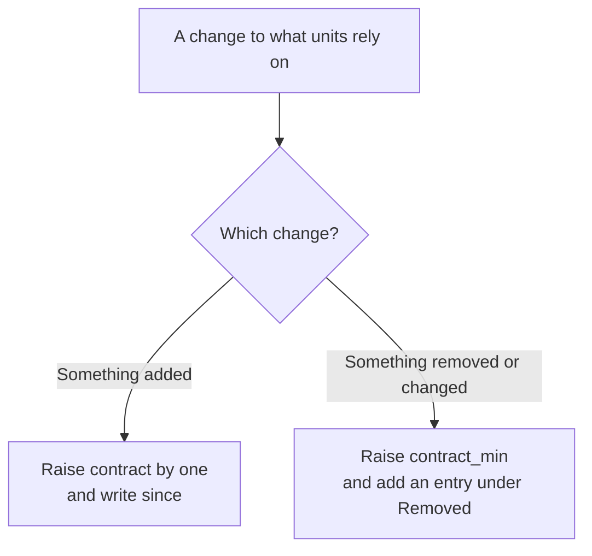

# The engine contract

The engine is the Lab itself: the core platform, the Lab UI and the seeder. The units of a catalog (its add-ons, setups
and playgrounds) run on it and rely on it: on the core's services, on the labels the Lab UI reads, on the folders a seed
may hold. This page lists what they may rely on. Anything not listed here is the engine's to change at any time. Read it
before you write a unit; the rules of the units themselves are in [units.md](units.md) and [playgrounds.md](playgrounds.md).

`contract.lock`, at the root of the repository, pins the page: one line per item. A test derives it from the files and fails
when the two differ, so a change to the contract is always a decision somebody wrote down.

## How a Lab reads a catalog

A Lab uses what it understands, and says when it needs a newer version. Nobody writes a compatibility number: the items of this
page that a catalog uses say which Lab reads it.

| The catalog | Uses something this Lab does not list (a key of `catalog.yml` or of `x-gravitee`, a label, a core service or network, a category, an anchor, a seed folder or file, a setting `SEED_*` of the seeder) |
|---|---|
| Published: a git catalog the person added, and each of its updates | Not used. The Lab installs the newest version it reads, and the catalog's row says a newer one needs a newer Gravitee Lab, which Update Gravitee Lab brings. A version is never run half understood |
| The person's own: a folder catalog, Personal, a working copy linked in place of an install | Used as it is: an unknown item is a mistake of its author, and `catalog.py check` names each one |

The Lab finds the newest version it reads by reading the files of each version, newest first, as it reads a catalog it adds
(`manifest.pick`, `understood`): its releases when it makes releases, else the commits before each change of its units, up to 20 versions, none started after about ten seconds, each once. When none of those is one it reads, the Lab says so and how many it read. A catalog's CI checks it with a released Lab: the commit
that `.github/standard.json` pins is the commit of a release `vX.Y.Z`. So a catalog that passes its CI is read by that release
and every later one, and updating to the latest release is always enough for what a catalog publishes. The release notes of
the Lab list, under *For catalogs*, what each release adds that a catalog can use (the label `catalog-format`,
[Publishing a version](maintaining.md#publishing-a-version)).

### The fields of older Labs

Older Gravitee Labs need `schema` and read `lab` in `catalog.yml`, and they read a unit's `x-gravitee.requires.lab`:
they ignore what they do not know, so `lab` tells them which catalogs they can run. This Lab needs none of them. `catalog.py`
keeps them true where it writes `catalog.yml` (`new`, `upgrade --write`, `release`, and the Share of an item into a catalog),
with the comment `# For older Gravitee Labs: written by catalog.py` on the lines it adds. `catalog.py check` accepts a
`catalog.yml` without them, and verifies a `lab` that is there: it is the highest level (`since`, below) among the items the
catalog uses, so that an older Lab refuses cleanly what it cannot run, and the fix is `catalog.py upgrade --write`. This Lab
reads a `lab` it does not read as a fast hint: that version is passed over without its files being read. These fields are
removed in a future major version of the Lab.

## Levels

The levels are the engine's own way to keep the contract in order; nothing a catalog author or a person writes or reads
mentions them. A level is a whole number. Level 1 is the state of the engine when catalogs were separated from it.

| Where | Name | What it says |
|---|---|---|
| `docker-compose.yml`, `x-gravitee` | `contract` | The newest level this engine provides. It grows with an addition that an older Lab could not run without |
| `docker-compose.yml`, `x-gravitee` | `contract_min` | The oldest level this engine still reads. It grows when something is removed or changed |
| `contract.lock` | `since` | The level an item appeared at: what the legacy `lab` of a catalog that uses it must be |

A core file without `contract` or `contract_min` reads as 1 for both.

## What a unit may rely on

### Core services

A unit reaches a core service by its name and its container port, on the network it shares with it. Every service has a
healthcheck, so a unit waits for one with `condition: service_healthy`.

| Service | Group | Container ports | Networks |
|---|---|---|---|
| `elasticsearch` | Databases | 9200 | `internal` |
| `mongodb` | Databases | 27017 | `internal` |
| `redis` | Databases | 6379 | `internal` |
| `alert-engine` | Alert Engine | none | `internal` |
| `apim-gateway` | API Management | 8082, 8443 | `edge`, `internal` |
| `apim-management-api` | API Management | 8083 | `edge`, `internal` |
| `apim-management-ui` | API Management | 8080 | `edge` |
| `apim-portal-ui` | API Management | 8080 | `edge` |
| `gamma-ui` | API Management | 8080 | `edge` |
| `am-gateway` | Access Management | 8092 | `edge`, `internal` |
| `am-management-api` | Access Management | 8093 | `edge`, `internal` |
| `am-management-ui` | Access Management | 8080 | `edge` |

A service that goes, or whose container ports, networks or healthcheck differ in any way, is a change, an added port or
network included (see [Raising contract_min](#raising-contract_min)).

### Networks

| Network | What is on it |
|---|---|
| `edge` | What users and API consumers reach: gateways, consoles, management APIs |
| `internal` | Databases and supporting services |

A unit puts its services on `internal`, and on `edge` when a person or an API consumer calls them.

### Settings of the core

Any variable the core file refers to is a setting that every unit may read besides its own, so there is no list to keep.
The settings that only a catalog's own units share are declared in its `catalog.yml`, in `shared_settings`.

| Setting | What it is |
|---|---|
| `GRAVITEE_LICENSE` | The Enterprise license, in base64 |
| `INTERNAL_API_PASSWORD` | The password of the user `admin` on the internal APIs and on the link to the Alert Engine |
| `REDIS_PASSWORD` | The password of the core's Redis |
| `MTLS_KEYSTORE_PASSWORD` | The password of `certs/mtls/server.p12` |

The image variables are the ones the Images page finds in the core. A unit that runs a Gravitee image writes
`${NAME_REGISTRY:-graviteeio}/repository:${NAME_VERSION:-tag}` with the variables of its component.

| Component | Version | Registry |
|---|---|---|
| API Management | `APIM_VERSION` | `APIM_REGISTRY` |
| API Management gateway | `APIM_GATEWAY_VERSION` | `APIM_GATEWAY_REGISTRY` |
| Access Management | `AM_VERSION` | `AM_REGISTRY` |
| Alert Engine | `AE_VERSION` | `AE_REGISTRY` |
| Elasticsearch | `ELASTICSEARCH_VERSION` | |
| MongoDB | `MONGODB_VERSION` | |
| Redis | `REDIS_VERSION` | |

### Categories

A unit's `category` is one of the core's: `Gravitee Platform`, `AI`, `Event`, `API`, `Observability`, `Other`.

### Keys of x-gravitee

A unit describes itself in the `x-gravitee` block of its compose file. A key outside this table is read by nothing, and
the check of a catalog reports it. *Kinds* says which kind of unit may carry the key, and the check refuses it on the others:
`any` is the three kinds.

| Key | Kinds | What it says |
|---|---|---|
| `x-gravitee.kind` | any | `addon`, `setup` or `playground` |
| `x-gravitee.name` | any | How the Lab UI names it |
| `x-gravitee.description` | any | A noun phrase without a leading article or a final period: what it adds. Its row in the list |
| `x-gravitee.category` | any | One of the categories above |
| `x-gravitee.tags` | any | Short labels shown on its page |
| `x-gravitee.duration` | any | How long the guide takes |
| `x-gravitee.first_start` | any | How long the first start takes, said next to Start until it is set up |
| `x-gravitee.source` | any | The repository its apps are built from, shown as a link |
| `x-gravitee.requires` | any | What it needs: the keys below |
| `x-gravitee.consoles` | any | The services whose UI shows in a tab next to the guide |
| `x-gravitee.accounts` | any | The sign-ins its guide uses, shown with copy buttons. A `password` and a `key` are settings, never literals |
| `x-gravitee.conflicts` | any | Maps each add-on it cannot run with to the reason. Only an add-on's is read |
| `x-gravitee.gateway` | addon | The gateway of a remote Gravitee that the add-on runs on this machine: `platform`, `service`, `token` |
| `x-gravitee.tested` | playground | The sets of versions it was built and checked on, the latest last |
| `x-gravitee.terminal` | playground | The service whose shell the terminal pane opens: one of its own or of what it includes, never its seed service |
| `x-gravitee.host_access` | any | Maps a service to the reason it takes more of this machine than its container does: it runs privileged, mounts the Docker socket, and so on |
| `x-gravitee.copy_of` | any | Written by the Lab in the person's copy of an item of a catalog (Copy to Personal): the id of the item it was copied from, its twin on this Lab. A catalog's item, and an exported file, never carry it. Only an item of Personal is read for it: an item of an import that says it cannot go to Personal, and runs in Imported as any other |
| `x-gravitee.private_from` | any | Written by the Lab when private content is copied or leaves (Copy to Personal, Share, Export): the name of the private catalog of Git it comes from, resolved when it is written. Move and Import to Personal carry the file as it is, with its label. It only adds a notice: what carries it is said under Private, and it makes no twin |

| Key of `requires` | Kinds | What it says |
|---|---|---|
| `x-gravitee.requires.images` | any | `{VERSION_VARIABLE: "minimum"}`: the oldest version of a component of the Images page it works with |
| `x-gravitee.requires.plugins` | any | The plugins a product must load |
| `x-gravitee.requires.license` | any | The license features it needs |
| `x-gravitee.requires.host` | any | Checks the Lab UI makes from this machine before Start: `name`, `check`, `expect`, `help` |
| `x-gravitee.requires.lab` | any | For older Gravitee Labs: the level the unit was written for ([The fields of older Labs](#the-fields-of-older-labs)). A unit does not need it |

### Labels

These are the `io.gravitee` labels the Lab UI reads from a service.

| Label | What it says |
|---|---|
| `io.gravitee.name` | The display name |
| `io.gravitee.description` | What the service is, in one short line. Every service of a shared unit has one |
| `io.gravitee.group` | The section of the Containers page: one of `x-gravitee.groups` of the core |
| `io.gravitee.console.<id>.name` | The name of a UI to open, once per UI |
| `io.gravitee.console.<id>.url` | Its address, a web address |
| `io.gravitee.console.<id>.legacy` | `"true"` lists it after the others |
| `io.gravitee.image.tags` | The Docker Hub repository that lists the image's tags, when its own registry lists them badly |
| `io.gravitee.role` | `seed` marks the service of a playground that creates its data in Gravitee |
| `io.gravitee.license` | `required` marks a service that exits without a usable license |

A label whose value the Lab acts on takes the values of this table, and a published catalog that gives it another needs a newer
Gravitee Lab:

| Label and value | What it says |
|---|---|
| `io.gravitee.role=seed` | The service is the seed of the playground |
| `io.gravitee.license=required` | The service exits without a usable license |
| `io.gravitee.console.<id>.legacy=true`, `io.gravitee.console.<id>.legacy=false` | The UI is listed after the others, or not |

### The seed

A playground's `seed/` folder holds what the seeder reads. A folder or a file that is absent costs nothing: a module
returns before it reads a setting or connects.

| Path in `seed/` | What it holds |
|---|---|
| `openfga` | OpenFGA store files |
| `am` | Access Management |
| `am/domain.yaml` | The domain, with its users |
| `am/applications` | Applications |
| `am/protected-resources` | MCP servers |
| `am/gamma-link.yaml` | The link from Gamma to the domain |
| `apim` | API Management |
| `apim/settings.yaml` | Environment settings |
| `apim/apis` | API exports, `.json` |
| `apim/applications` | Applications |
| `apim/subscriptions` | Subscriptions |
| `aim` | Agent Management, in Gamma |
| `aim/credentials` | Credentials |
| `aim/providers` | AI providers |
| `aim/models` | AI models |
| `aim/mcp-servers` | MCP servers |
| `aim/knowledge` | Knowledge |
| `aim/skills` | Skills |
| `aim/agents` | Agents |
| `aim/api-tools` | API tools |
| `aim/workspaces` | AI workspaces |
| `aim/mcp-proxies` | MCP proxies |
| `aim/studios` | Studios |
| `aim/dashboards` | Dashboards |
| `aim/governance` | Governance |
| `aim/governance/approvals.yaml` | Approvals |
| `aim/governance/compliance.yaml` | Compliance |
| `authz` | Authorization Management, in Gamma |
| `authz/entities.yaml` | What the policies are about |
| `authz/policies` | Policies |
| `authz/schemas` | Schemas |
| `authz/schema.yaml` | The schema, in one file |
| `controls.yaml` | The protections a lesson switches on |
| `refills.yaml` | What a lesson spends, given back on every run |
| `environments` | Environments: a folder per environment, `environments/<id>/`, that holds `environment.yaml`, `settings.yaml`, `users.yaml` and the folders `groups`, `apis`, `applications`, `subscriptions` and `portal`, as `apim` does |
| `k8s` | Kubernetes |

The formats are in [the seed](playgrounds.md#the-seed). The seed service sets the seeder's settings in its environment,
and a seed file uses `${VAR}` for everything that depends on the target. These are the settings the seeder reads, with
their meaning and defaults in [Settings](playgrounds.md#settings):

| For | Settings |
|---|---|
| API Management | `APIM_MANAGEMENT_URL`, `APIM_MANAGEMENT_PATH`, `APIM_PORTAL_PATH`, `APIM_ORG`, `APIM_ENV`, `APIM_TOKEN`, `APIM_USERNAME`, `APIM_PASSWORD` |
| Access Management | `AM_MANAGEMENT_URL`, `AM_PUBLIC_URL`, `AM_ORG`, `AM_ENV`, `AM_TOKEN`, `AM_USERNAME`, `AM_PASSWORD`, `GAMMA_AM_URL` |
| Gamma | `AIM_GAMMA_URL`, `AIM_AUTOMATION_URL` |
| OpenFGA | `OPENFGA_API_URL` |
| The gateway | `GATEWAY_INTERNAL_URL`, `SEED_WAIT_GATEWAY`, `GATEWAY_READY_TIMEOUT`, `GATEWAY_SYNC_SECONDS`, `LLM_PROBE_KEY` |
| Kubernetes | `KUBECONFIG` |
| Redis, for refills | `REDIS_URL`, `REDIS_PASSWORD` |
| The run | `SEED_PROTECTIONS`, `READY_TIMEOUT`, `SEED_WORKERS`, `SEED_DIR`, `STATE_DIR` |

The seeder records what it creates in `.state/created.json`, in the folder of the playground: a list of `{product, kind,
label, name, id}` objects, plus the keys a module adds. The Lab UI reads it to offer *Delete what it created* and to list
what that deletes.

### Frames

The Lab UI shows a playground's UIs in frames next to its guide, and exchanges four messages (`window.postMessage`) with
them. Each side checks the origin and the window a message comes from. The Lab UI is served on port 9000, at
`http://localhost:9000` or `http://127.0.0.1:9000`: the two pages that the core's UIs and the apps let frame them.

| Message | From, to | Payload | Means |
|---|---|---|---|
| `gravitee-lab:action` | The Lab UI, to the frame of the first console | `{type, id}` | Run the action `id` of the guide |
| `gravitee-lab:ready` | The app, to the Lab UI | `{type}` | The app listens for actions |
| `gravitee-lab:open` | The app, to the Lab UI | `{type, url}` | Show this address in the Lab UI's own tab |
| `gravitee-lab:location` | A UI, to the Lab UI | `{type, url}` | The address the UI is on now |

### Anchors

An anchor is a place in the engine that a unit may point to.

| Anchor | What a unit does with it |
|---|---|
| `seeder` | Builds the seeder from the engine's `seeder/` folder, and runs the image that `x-gravitee.seeder.image` names in the core file. It is the only image a seed service may have |
| `plugins/apim` | Mounts the plugins of API Management, to give another service the plugins of the core's gateway |
| `plugins/am` | Mounts the plugins of Access Management |
| `lab-ui` | Lets the Lab UI frame it: the Lab UI is served on port 9000, at the two addresses of [Frames](#frames) |

### Guides

A guide is a Markdown file. A `run` block in it has a button that runs its commands in the playground's terminal, the
service that `x-gravitee.terminal` names.

| Block | What it does |
|---|---|
| `run` | Runs in the terminal pane from a button of the guide |

## Changing the contract

**Never change the meaning of an existing key, field or label: add a new one instead.** A Lab that does not know a new key says
it needs a newer Gravitee Lab; a Lab that knows a key and reads it another way would misread a catalog without a word. So a key keeps
what it says, its values and the kinds of unit that may carry it, for as long as it is read; when it must say something else, a
new key says it, and the old one is removed by the rules of [Raising contract_min](#raising-contract_min). The test of the lock
enforces what the files show: an item that goes, or whose attributes change (the ports, the healthcheck and the networks of a
core service, the kinds that read a key), stops the build until `contract_min` is raised and the item is named under
[Removed](#removed). What a value means is for the review of the pull request.

A pull request that adds an item gets the label `catalog-format`, so that its release lists it under *For catalogs*.



The lock is never written by hand. After a change, from the root of the repository:

```bash
cd lab-ui && python3 -m tests.test_contract --write
```

Without `--write` the command prints the lock it would write, and says on the standard error what stops it. It reads
`docker-compose.yml`, the keys of `check.py`, the modules of `seeder/` and the scripts of the page, so it needs Docker
Compose 5 and no daemon. `lab-ui/tests/test_contract.py` runs the same comparison and fails with what to raise.

A lost lock is restored from git, never written again: a new one would give every item the current level, and `since`
is the history that the verification of `lab` reads. The command refuses to write a first lock once `contract` is past 1.

### The lock

`contract.lock` starts with the two levels, then holds one line per item: its kind, its name, its attributes and its
level. A name with a space is in double quotes.

```
contract 1
contract_min 1
core.service apim-gateway port=8082,8443 health=yes networks=edge,internal since=1
label io.gravitee.role since=1
```

| Kind | Item | Attributes |
|---|---|---|
| `core.service` | A service of the core | `port` (its container ports), `health`, `networks` |
| `core.network` | A network of the core | |
| `core.variable` | A setting the core refers to | |
| `core.image_variable` | A version or registry setting of an image | |
| `core.category` | A category | |
| `unit.key` | A key of `x-gravitee` or of its `requires` | `kinds` |
| `label` | An `io.gravitee` label | |
| `label.value` | A value of a label the Lab acts on, as `label=value` | |
| `seed.folder`, `seed.file` | A folder or a file of a seed | |
| `seed.setting` | A setting of the seeder | |
| `frame.message` | A message between the Lab UI and a frame | |
| `anchor` | An anchor | `port` and `hosts`, for `lab-ui` |
| `guide.block` | A block of a guide | |

### Raising contract

Raise `contract` by one for every addition: a service, a key, a label or a value of one, a seed folder, a message. One
change raises it by one, however many items it adds.

1. Raise `contract` in `docker-compose.yml`.
2. Write the lock. The new items get `since` equal to the new level; the others keep theirs.
3. Describe the items on this page.

There is no optional addition: a Lab released before it does not read a catalog that uses it, so the legacy `lab` of that
catalog rises with it and older Gravitee Labs, which read levels, refuse it as cleanly. A kind the lock lists for the first
time, whose items were read before (the values of a label), takes the level of the items it belongs to, once.

A catalog uses a new item once a release of the Lab has it: its CI checks it with the release its `.github/standard.json` pins,
which says what is not read yet until the catalog moves to that release (`catalog.py upgrade --lab-ref latest`).
`catalog.py check` tells the catalog the legacy `lab` that older Labs need.

### Raising contract_min

Raise `contract_min` when an item is removed or changed: a service that goes or whose container ports, networks or
healthcheck differ in any way, a key that is no longer read. A catalog written for a lower level may rely on it, so the
engine stops reading that level. All of these hold first:

- The default catalog's latest commit passes `catalog.py check` at the new floor.
- This page has an entry under [Removed](#removed) that names the item between backticks and says what went and
  what replaces it. The command that writes the lock stops until every item removed or changed is named there.
- At least two levels stay readable under the newest: `contract_min <= contract - 2`. At the very beginning, while
  `contract` is 2 or lower, `contract_min` may rise to `contract`.
- `contract_min` never passes `contract`: at level 1, the first removal raises `contract` to 2 in the same change.

Raise `contract_min` only once the catalog has a commit written for the new floor. The Lab installs the newest commit it
can read, so a mistake in this order is a short, visible delay and not a first start that fails.

## Removed

Nothing has been removed. `contract_min` is 1.
