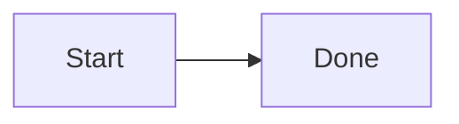

# A guide

Start with [the readme](../README.md) and the [other page](other.md#section "a title"). A table of items:

| Item | What it does |
|---|---|
| [Hello](../addons/hello/) | Says hello |
| [Missing nothing](other.md?view=1) | A query is not part of the file |

A link to a [console](http://localhost:9000/) and one to [Gravitee](https://www.gravitee.io/), a mail to <mailto:someone@example.test>
and an action of the Lab: [start it](action:start-hello). A setting is `${HELLO_PORT:-8080}` in the text, and a link
[with a variable](${DOCS_URL}/page) is left to the Lab.

 and another over https: 

```html
<script>alert("this is only shown")</script>
<form action="/x"><input onclick="y()"></form>
<iframe src="javascript:alert(1)"></iframe>
```

~~~
<object data="x"></object> [broken](missing-in-a-fence.md)
~~~

The inline code `<embed src=x>` and ``a `<form>` with a tick`` are shown, not run.



[ref]: other.md "A reference"
[ext]: https://example.test/page
Text with an angle < 3 and a > b, an on=1 setting and the word online=true in prose.
